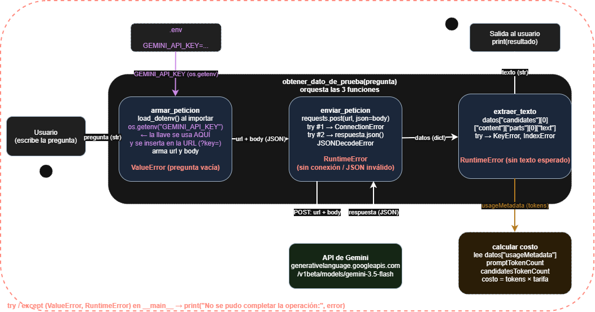

# Decisión de arquitectura: elección de modelo

Gamaliel Guerra Venegas · 20 de octubre de 2026

## Modelo elegido

Me quedo con `gemini-3.5-flash`, el modelo de Google que ya uso en la miniaplicación desde `src/consumir_gemini.py`, llamando al endpoint `generateContent` de la API de Gemini.

## Diagrama de arquitectura

Este es el diagrama que armé en el Bloque 8. Muestra el recorrido completo: el usuario escribe una pregunta, la llave se lee del `.env`, pasan las tres funciones (`armar_peticion`, `enviar_peticion` y `extraer_texto`), se llama a la API de Gemini y al final se calcula el costo con los datos de `usageMetadata`.

El modelo que aparece en el cuadro "API de Gemini" del diagrama es el mismo que elegí en este documento.

## Comparación de candidatos

Los precios son en dólares por millón de tokens, del tier de pago de la Gemini Developer API, según la [página oficial de precios](https://ai.google.dev/gemini-api/docs/pricing) (la revisé el 20/10/2026). Los tokens de razonamiento se cobran como tokens de salida.

| Criterio | `gemini-3.5-flash` (elegido) | `gemini-3.1-pro-preview` (descartado) |
|---|---|---|
| Precio de entrada (por 1M tokens) | $1.50 | $2.00 (prompts de hasta 200k) |
| Precio de salida (por 1M tokens) | $9.00 | $12.00 (prompts de hasta 200k) |
| Latencia promedio (5 peticiones) | 5.52 s | No la pude medir: mi llave es del tier gratuito y no tiene cuota para este modelo (error 429, `RESOURCE_EXHAUSTED`) |
| Costo por request (21 tokens de entrada y 643 de salida) | $0.005818 (medido) | $0.007758 (calculado con esos mismos tokens) |
| Calidad | Suficiente para respuestas directas | Razona más a fondo y da respuestas más elaboradas |
| Estado | Estable | Preview |

El costo sale de `(tokens de entrada × precio de entrada + tokens de salida × precio de salida) / 1.000.000`. Los tokens de Flash los medí con un script que manda la misma pregunta cinco veces y promedia los resultados. Para el Pro usé esos mismos tokens, porque no pude llamarlo, así que su costo es una estimación y no una medición.

## Justificación

Elegí `gemini-3.5-flash` porque mi miniaplicación hace consultas simples de pregunta y respuesta, y para eso una respuesta clara ya es suficiente. Lo que más pesó fue el costo: cada request me sale en $0.005818, y con el Pro pagaría un 33 % más por la misma consulta. Con pocas peticiones la diferencia es mínima, pero crece con el uso. La latencia fue el segundo criterio: 5.52 s es aceptable para lo que hace la aplicación.

Además, Flash ya está integrado y probado en mi código, con su manejo de errores y la validación de la pregunta, así que mantenerlo no me obliga a cambiar nada.

## Alternativa descartada y por qué

Descarté `gemini-3.1-pro-preview`. Es el que da soluciones más pensadas, y fue justo el que quise probar al principio, pero no me convenció para este caso por tres motivos:

1. Es más caro: $0.007758 por request frente a $0.005818, con los mismos tokens. Y como los tokens de razonamiento se cobran como salida, en la práctica puede salir todavía más caro.
2. No tengo acceso con mi llave gratuita. Al probarlo, la API me devolvió el error 429 y me pidió esperar unas 7.6 horas, o sea que tendría que activar la facturación solo para poder usarlo. Por eso tampoco tengo su latencia medida.
3. Está en preview, así que su disponibilidad y sus precios pueden cambiar con menos aviso que un modelo estable.

Lo volvería a considerar si la miniaplicación empezara a necesitar razonamiento más complejo, como análisis de varios pasos o generación de código, y si tuviera una llave con facturación activa. En ese caso sí valdría la pena pagar más por una mejor calidad.
